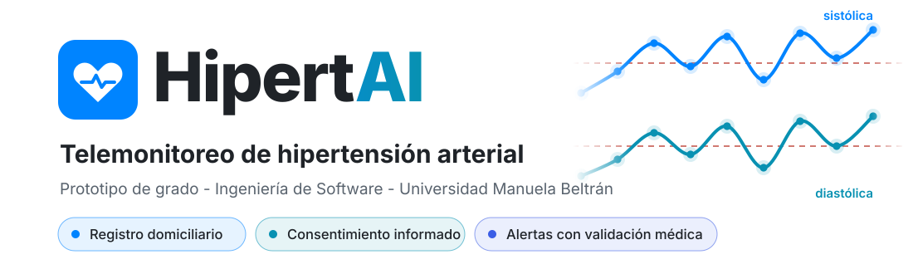
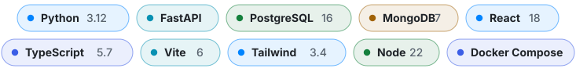
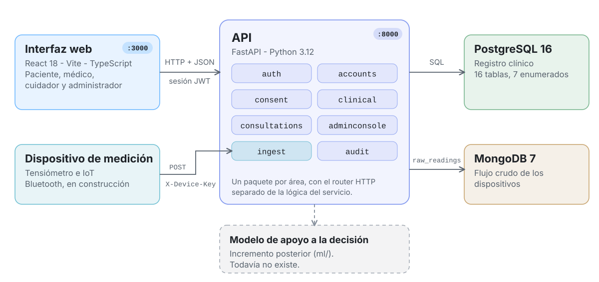
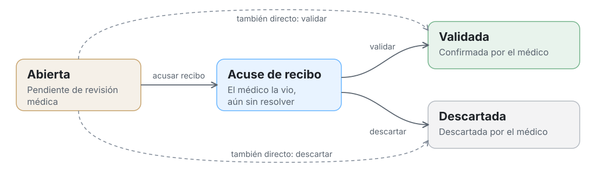
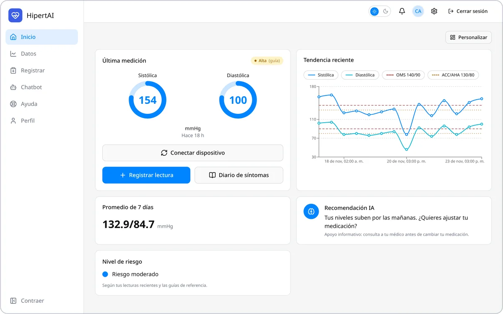
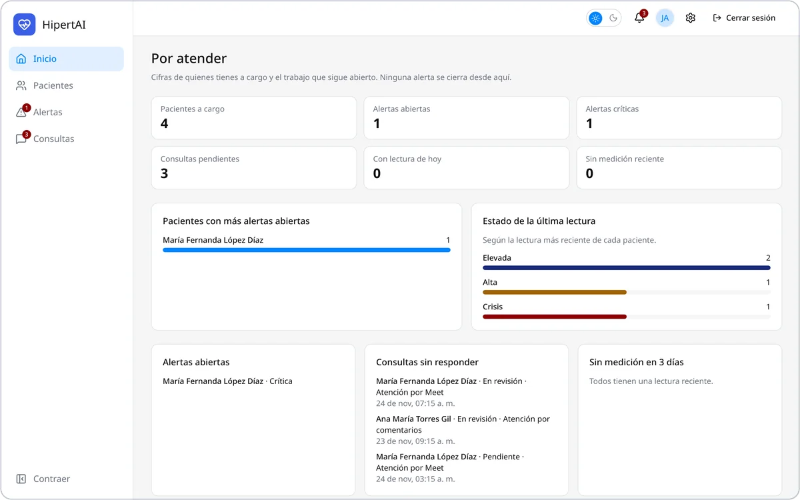
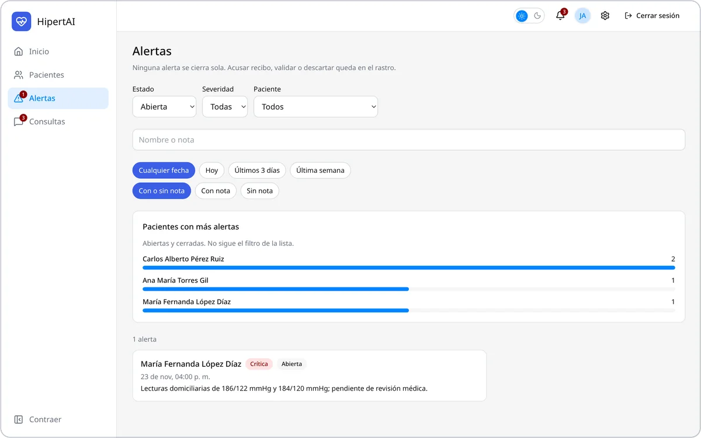
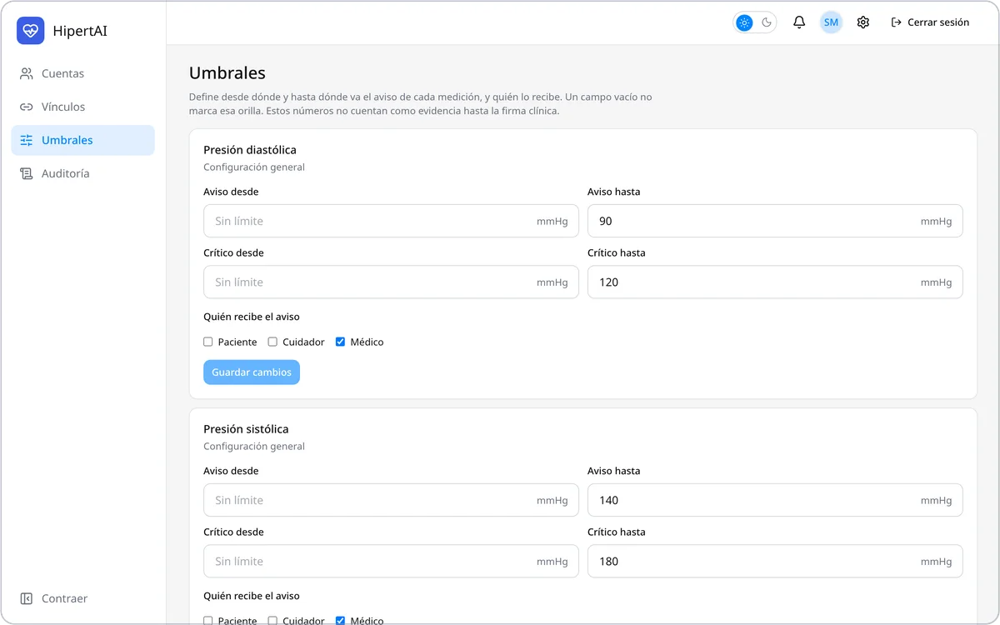

<div align="center">

<picture>
  <source media="(prefers-color-scheme: dark)" srcset="docs/assets/banner-oscuro.svg">
  <source media="(prefers-color-scheme: light)" srcset="docs/assets/banner-claro.svg">
  
</picture>

<br>

[](https://github.com/J0ss077/UMB-proyecto-cardiaco/actions/workflows/ci.yml)
[](https://github.com/J0ss077/UMB-proyecto-cardiaco/commits/main)
[](https://github.com/J0ss077/UMB-proyecto-cardiaco)

**[Inicio rápido](#inicio-rápido)** &nbsp;-&nbsp; **[Arquitectura](#arquitectura)** &nbsp;-&nbsp; **[Interfaz](#la-interfaz)** &nbsp;-&nbsp; **[Pruebas](#pruebas-y-verificación)** &nbsp;-&nbsp; **[Documentación](#documentación)**

</div>

## Qué es

Plataforma de telemonitoreo para el seguimiento domiciliario de pacientes con hipertensión arterial, construida como prototipo de grado de Ingeniería de Software en la Universidad Manuela Beltrán. Registra lecturas y síntomas, pide el consentimiento informado, levanta alertas que un médico valida y permite al paciente consultar a su médico.

> [!IMPORTANT]
> La plataforma no diagnostica ni trata. Ninguna alerta se cierra sola: la mueve una persona y cada paso queda en la auditoría.

Con la pila levantada, la interfaz se abre en `http://localhost:3000`. La API responde en `http://localhost:8000/api/health` y se explora en `http://localhost:8000/docs`.

## Qué hace

Cuatro roles comparten la misma plataforma, cada uno con su recorrido:

<table>
  <tr>
    <td align="center" valign="top" width="50%">
      <br>
      <strong>Paciente</strong><br>
      Registra lecturas y síntomas, sigue su tendencia, descarga su historial en Excel y PDF y consulta a su médico.
    </td>
    <td align="center" valign="top" width="50%">
      <br>
      <strong>Médico</strong><br>
      Revisa a sus pacientes, acusa recibo, valida o descarta alertas y responde consultas con enlace de Meet o formato de chequeo.
    </td>
  </tr>
  <tr>
    <td align="center" valign="top" width="50%">
      <br>
      <strong>Cuidador</strong><br>
      Ve a quien lo autorizó, lee sus alertas en solo lectura y sigue una guía gráfica de actuación.
    </td>
    <td align="center" valign="top" width="50%">
      <br>
      <strong>Administrador</strong><br>
      Gestiona cuentas, vínculos, umbrales de alerta y el registro de auditoría.
    </td>
  </tr>
</table>

Tres reglas sostienen el diseño:

| Regla | Qué significa |
| :--- | :--- |
| **Consentimiento primero** | Ningún dato clínico se escribe ni se analiza sin un consentimiento informado vigente. |
| **Una persona cierra cada alerta** | Una alerta pasa de abierta a acuse, validada o descartada solo por decisión de un médico. |
| **Lo fuera de rango se conserva** | Un valor fuera de rango no se descarta: queda marcado con `out_of_range` para que alguien lo revise. |

> [!NOTE]
> Es un prototipo y declara sus límites en la propia interfaz. El modelo de apoyo a la decisión todavía no existe, de modo que la tarjeta de recomendación muestra un texto fijo y el chatbot avisa que no responde. La conexión por Bluetooth con dispositivos IoT está en construcción: hoy la ingesta recibe las lecturas por HTTP. El estado de cada requerimiento está en [`docs/estado-requerimientos.md`](docs/estado-requerimientos.md).

## Arquitectura

<div align="center">
  <picture>
    <source media="(prefers-color-scheme: dark)" srcset="docs/assets/tecnologias-oscuro.svg">
    <source media="(prefers-color-scheme: light)" srcset="docs/assets/tecnologias-claro.svg">
    
  </picture>
</div>

<picture>
  <source media="(prefers-color-scheme: dark)" srcset="docs/assets/diagramas/arquitectura-oscuro.svg">
  <source media="(prefers-color-scheme: light)" srcset="docs/assets/diagramas/arquitectura-claro.svg">
  
</picture>

La pila de contenedores tiene cuatro servicios:

| Servicio | Imagen | Puerto por omisión | Para qué sirve |
| :--- | :--- | :---: | :--- |
| `web` | Node 22, compila con Vite y sirve `dist/` | `3000` | Interfaz de los cuatro roles |
| `backend` | Python 3.12, FastAPI | `8000` | Sesión, cuentas, consentimiento, datos clínicos, alertas, consultas e ingesta |
| `db` | `postgres:16-alpine` | `5432` | Registro clínico, con dieciséis tablas |
| `mongo` | `mongo:7` | `27017` | Flujo crudo de los dispositivos |

El backend separa un paquete por área en `backend/src/hta/`, y cada paquete divide el `router.py` (HTTP) del `service.py` (lógica). Las decisiones de diseño están en los [ADR](docs/adr/).

### Ciclo de una alerta

<picture>
  <source media="(prefers-color-scheme: dark)" srcset="docs/assets/diagramas/ciclo-alerta-oscuro.svg">
  <source media="(prefers-color-scheme: light)" srcset="docs/assets/diagramas/ciclo-alerta-claro.svg">
  
</picture>

Solo el médico mueve una alerta. El paciente y el cuidador la consultan, y el cuidador la ve en solo lectura. Los umbrales viven en `alert_config`, se siembran con su fuente documentada y no cuentan como evidencia clínica hasta que un clínico los firme.

## La interfaz

Capturas de la pila en ejecución con las cuentas de demostración. Los datos son sintéticos y la interfaz sigue el tema claro u oscuro del sistema.

<p align="center">
  <picture>
    <source media="(prefers-color-scheme: dark)" srcset="docs/assets/interfaz/inicio-paciente-oscuro.webp">
    <source media="(prefers-color-scheme: light)" srcset="docs/assets/interfaz/inicio-paciente-claro.webp">
    
  </picture>
  <picture>
    <source media="(prefers-color-scheme: dark)" srcset="docs/assets/interfaz/inicio-medico-oscuro.webp">
    <source media="(prefers-color-scheme: light)" srcset="docs/assets/interfaz/inicio-medico-claro.webp">
    
  </picture>
</p>

<p align="center">
  <picture>
    <source media="(prefers-color-scheme: dark)" srcset="docs/assets/interfaz/alertas-medico-oscuro.webp">
    <source media="(prefers-color-scheme: light)" srcset="docs/assets/interfaz/alertas-medico-claro.webp">
    
  </picture>
  <picture>
    <source media="(prefers-color-scheme: dark)" srcset="docs/assets/interfaz/umbrales-administrador-oscuro.webp">
    <source media="(prefers-color-scheme: light)" srcset="docs/assets/interfaz/umbrales-administrador-claro.webp">
    
  </picture>
</p>

<p align="center"><sub>De izquierda a derecha y de arriba abajo: inicio del paciente, inicio del médico, bandeja de alertas y umbrales del administrador.</sub></p>

La tarjeta de recomendación del inicio del paciente muestra un texto fijo: el modelo de apoyo a la decisión todavía no existe.

El recorrido completo por rol, en escritorio y en móvil, está en [`docs/capturas/`](docs/capturas/README.md).

## Inicio rápido

### Requisitos

- `git` y `make`.
- `podman-compose` o `docker compose`, con el motor de contenedores en marcha.
- Puertos libres: 8000 para la API, 3000 para la interfaz, 5432 para PostgreSQL y 27017 para MongoDB. Se cambian con `BACKEND_PORT`, `WEB_PORT`, `POSTGRES_PORT` y `MONGO_PORT`.

### Levantarlo

```bash
cp .env.example .env
python3 -c "import secrets; print(secrets.token_urlsafe(48))"
# pega el resultado en HTA_JWT_SECRET dentro de .env
make up
make seed
```

El backend no arranca si `HTA_JWT_SECRET` conserva el valor de ejemplo o mide menos de 32 bytes.

`make up` usa `podman-compose` si está instalado y, si no, `docker compose`. `make seed` crea las siete cuentas y los datos de demostración, y se puede repetir sin duplicarlos. Para detener la pila: `make down`.

Si otra pila ya usa esos puertos, define `BACKEND_PORT`, `POSTGRES_PORT`, `MONGO_PORT` y `WEB_PORT` en `.env` y vuelve a ejecutar `make up`.

### Cuentas de demostración

Las siete cuentas, la contraseña común y lo que se puede recorrer con cada una están en [`docs/manual/cuentas-demo.md`](docs/manual/cuentas-demo.md). Los datos son sintéticos.

> [!WARNING]
> Las credenciales de PostgreSQL en `.env.example` y la contraseña de las cuentas son públicas a propósito: sirven en una máquina local. Antes de un host compartido hay que cambiarlas, y no dejar el puerto de MongoDB abierto.

<details>
<summary>Abrir PostgreSQL desde DBeaver o pgAdmin</summary>

<br>

Host `localhost`, puerto `POSTGRES_PORT` (5432 por omisión), base `POSTGRES_DB`, usuario `POSTGRES_USER` y contraseña `POSTGRES_PASSWORD`.

</details>

### Ejemplos de uso

Comprobar que la API responde:

```bash
curl http://localhost:8000/api/health
```

Enviar una lectura como lo haría un dispositivo. La clave sale de `HTA_DEVICE_KEY` en `.env`, y el identificador es el de la cuenta de un paciente con consentimiento vigente. El contrato completo está en [`docs/api/ingesta.md`](docs/api/ingesta.md).

```bash
curl -X POST http://localhost:8000/api/ingest/readings \
  -H "Content-Type: application/json" \
  -H "X-Device-Key: clave-de-prueba" \
  -d '{"device_id": "tensiometro-1", "patient_id": "<identificador-del-paciente>", "systolic": 130, "diastolic": 85, "heart_rate": 72, "measured_at": "2026-11-08T10:00:00Z"}'
```

## Estructura del repositorio

| Ruta | Contenido |
| :--- | :--- |
| [`backend/`](backend/) | API y lógica: sesión, cuentas, consentimiento, datos clínicos, alertas, consultas e ingesta |
| [`web/`](web/) | Interfaz de paciente, médico, cuidador y administrador. Cómo trabajarla está en [`web/README.md`](web/README.md) |
| [`db/`](db/) | Migraciones del registro clínico y colecciones del flujo crudo |
| [`iot/`](iot/) | Contrato de ingesta de dispositivos |
| [`scripts/`](scripts/) | Generadores de la trazabilidad y verificadores de autoría y estilo |
| [`docs/`](docs/) | Manual, ADRs, contrato de la API, estado de los requerimientos e investigaciones |
| [`compose.yaml`](compose.yaml) | Orquestación de los cuatro servicios |
| [`.github/`](.github/workflows/ci.yml) | Integración continua |

La carpeta `ml/` aparece con el incremento que construye el modelo de apoyo a la decisión.

## Pruebas y verificación

Antes de la primera ejecución: `python3 -m pip install -e './backend[dev]'`.

```bash
make test    # unitarias e integración
make check   # autoría, estilo y pruebas
```

Las unitarias no tocan base de datos. Las de integración usan el PostgreSQL y el MongoDB de la pila, así que piden `make up` antes. Las pruebas de la interfaz se corren desde `web/`, como dice su [README](web/README.md).

El contrato HTTP vive en `docs/api/openapi.json` y se regenera con `make contract`.

La integración continua de [GitHub Actions](.github/workflows/ci.yml) corre en cada push y pull request a `main`: las pruebas unitarias y de integración del backend contra PostgreSQL 16 y MongoDB 7, y los verificadores de autoría y estilo.

## Documentación

| Documento | Contenido |
| :--- | :--- |
| [Manual](docs/manual/) | Requerimientos, modelo de datos, umbrales clínicos, cuentas de demostración y [entrega del incremento 1](docs/manual/entrega-01.md) |
| [Contrato de la API](docs/api/api-para-el-frontend.md) | Rutas, cuerpos y errores para quien construye el cliente. El esquema generado está en `docs/api/openapi.json` |
| [Ingesta de dispositivos](docs/api/ingesta.md) | Clave de dispositivo, cuerpo de la petición y deduplicación de lecturas |
| [Estado de los requerimientos](docs/estado-requerimientos.md) | Estado de cada requerimiento, generado |
| [Decisiones de arquitectura](docs/adr/) | Por qué se eligió cada cosa, una decisión por archivo |
| [Diagramas UML](docs/uml/README.md) | Casos de uso, entidad-relación, clases, estados, secuencia, componentes y distribución, con su código PlantUML |
| [Capturas](docs/capturas/README.md) | Capturas del prototipo por rol, en escritorio y en móvil |
| [Interfaz web](web/README.md) | Desarrollo con Vite, comandos y pruebas del navegador |
| [Backend](backend/README.md) | Configuración, estructura del paquete y comandos |

<div align="center">

<sub>Universidad Manuela Beltrán &nbsp;-&nbsp; Ingeniería de Software &nbsp;-&nbsp; Proyecto de grado</sub>

</div>
