# Diagramas UML del sistema

Este documento reúne los seis diagramas que el manual técnico exige y que todavía no existían:
clases, estados por clase, colaboración por proceso, secuencia por proceso, componentes y
distribución.

Cada bloque `plantuml` es independiente: se copia tal cual en la herramienta web y se
renderiza solo. Los identificadores de los procesos son los del manual, CU-01 a CU-12, y los
de los actores son los cuatro roles que el esquema ya distingue.

Dos convenciones que valen para todo el documento. Los nombres de clase van en inglés
singular, igual que las tablas, para que el diagrama se pueda cotejar con el modelo
relacional y con el código; el texto que los rodea va en español, que es la lengua del manual.
Las clases persistentes llevan los atributos que la base guarda; las clases de dominio, que no
se guardan enteras, llevan las operaciones que el manual describe en sus casos de uso.

## 7. Diagrama de clases

Las dieciséis entidades del registro clínico, los siete tipos enumerados y las clases de
dominio que sostienen el análisis, las alertas y los reportes. Las asociaciones con
multiplicidad son las del modelo relacional; las clases de dominio no se persisten y existen
para que las operaciones del sistema tengan dueño.

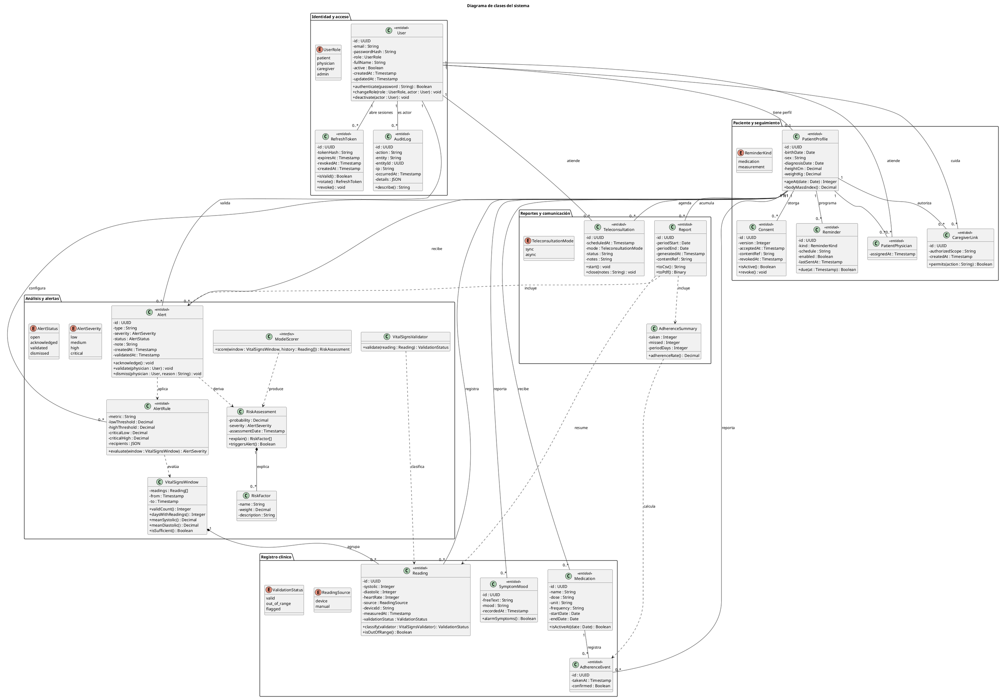

## 8. Diagramas de estados por clase

Un diagrama por clase con ciclo de vida propio. Las clases que no aparecen aquí
(`PatientProfile`, `PatientPhysician`, `CaregiverLink`, `SymptomMood`, `AuditLog`, `Report`,
`AlertRule`, `VitalSignsWindow`, `RiskAssessment`, `RiskFactor`) son registros, asociaciones
o valores calculados: existen desde que se crean hasta que se consultan, y un diagrama de
estados sobre ellos no diría nada que el diagrama de clases no diga ya.

### 8.1 Usuario

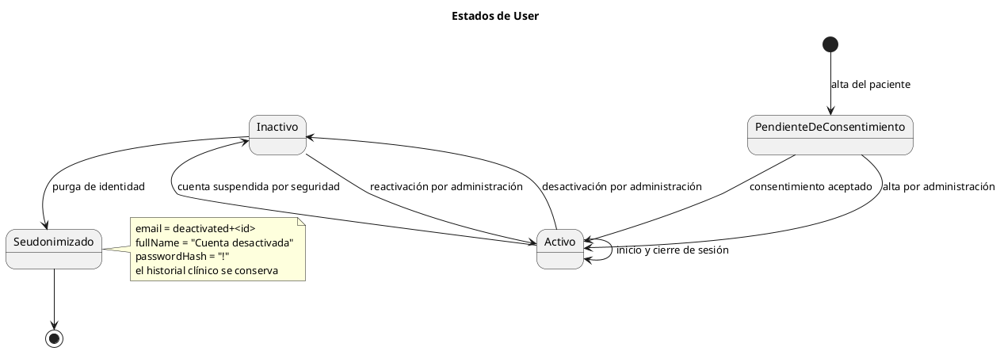

### 8.2 Consentimiento

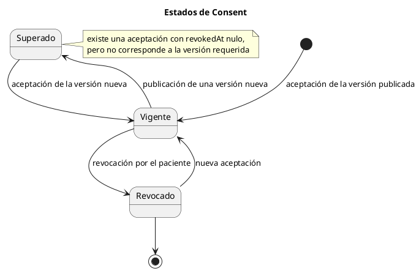

### 8.3 Lectura

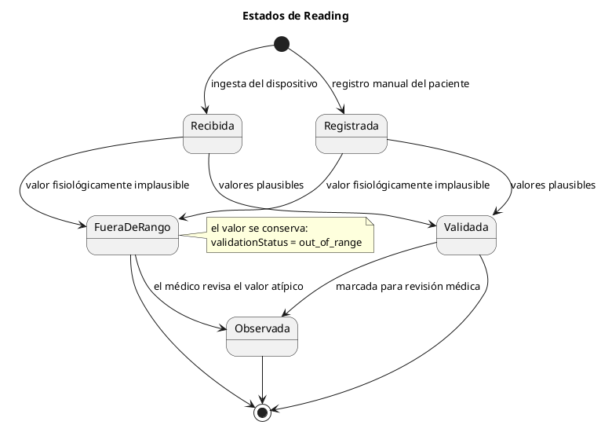

### 8.4 Alerta

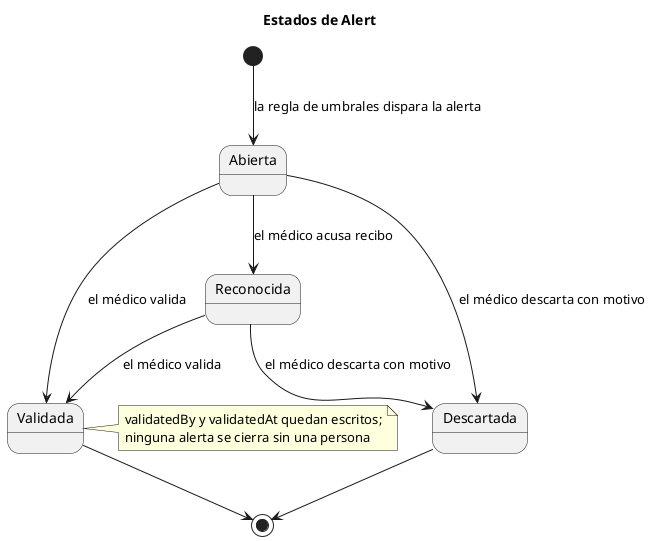

### 8.5 Token de refresco

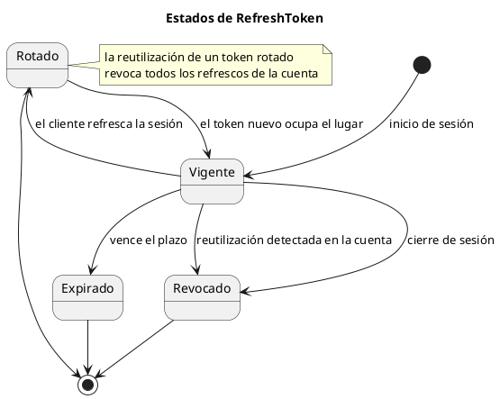

### 8.6 Medicamento

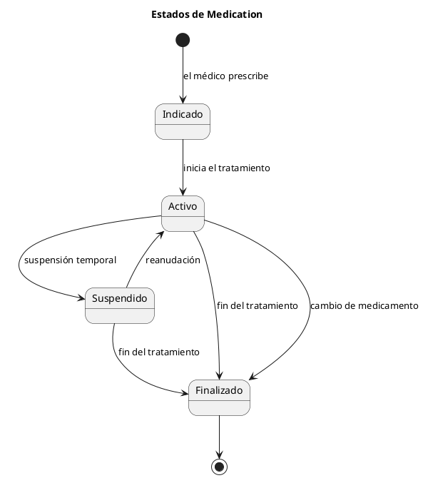

### 8.7 Evento de adherencia

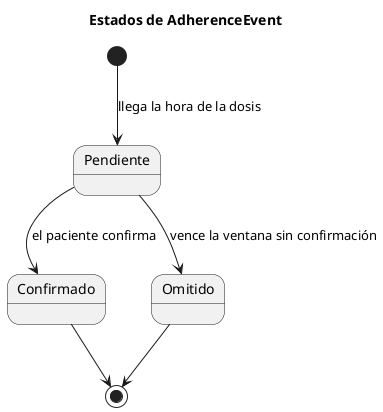

### 8.8 Recordatorio

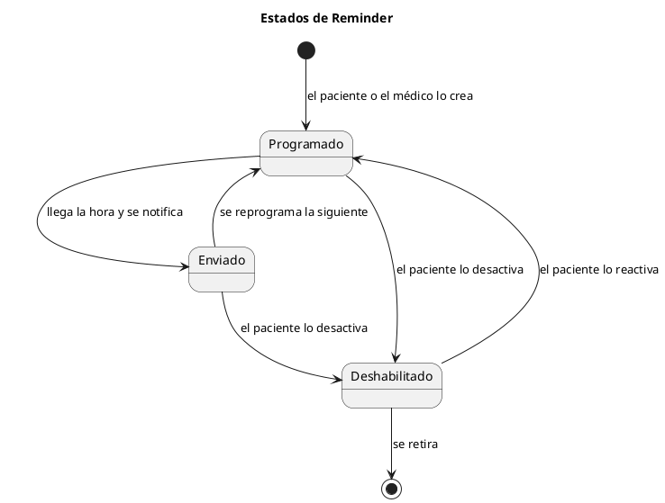

### 8.9 Teleconsulta

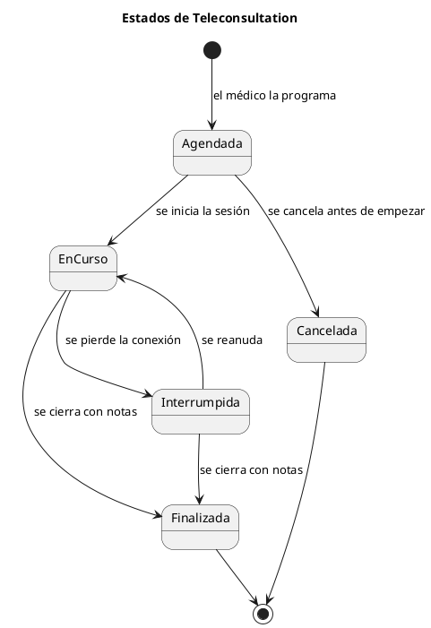

### 8.10 Modelo de clasificación

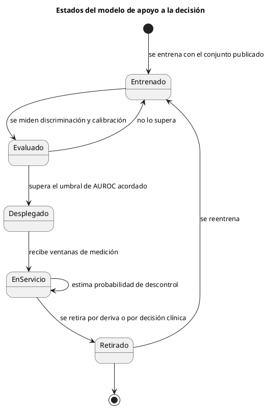

## 9. Diagramas de colaboración por proceso

Un diagrama de colaboración muestra los mismos objetos que la secuencia, pero ordenados por
sus enlaces en lugar de por el tiempo: los mensajes van numerados y esa numeración es el
orden. PlantUML no tiene una notación propia para este diagrama, así que se dibuja con
objetos y mensajes numerados, que es la forma habitual de representarlo.

### 9.1 CU-01 Autenticación y acceso al sistema

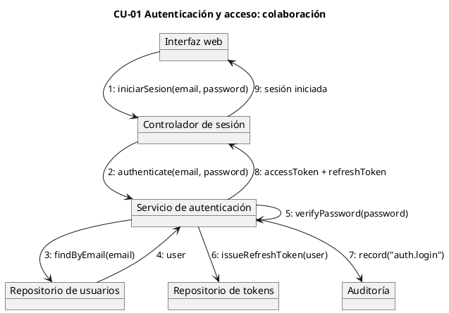

### 9.2 CU-02 Gestión del consentimiento informado

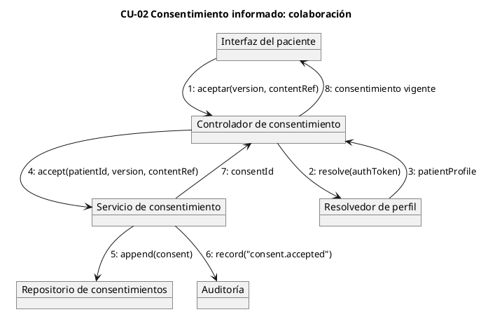

### 9.3 CU-03 Captura automática de signos vitales

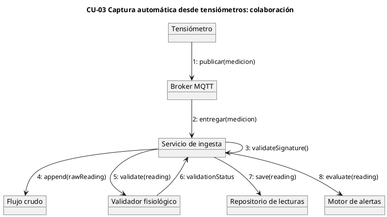

### 9.4 CU-04 Registro manual de presión arterial y síntomas

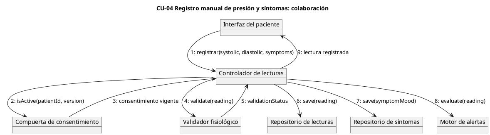

### 9.5 CU-05 Análisis y clasificación de riesgo

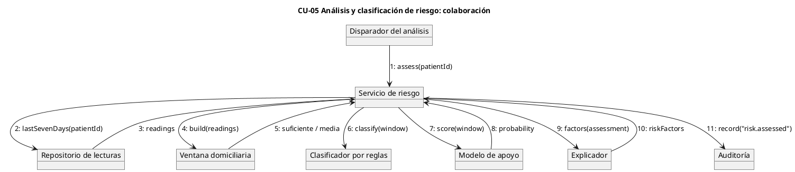

### 9.6 CU-06 Generación y gestión de alertas

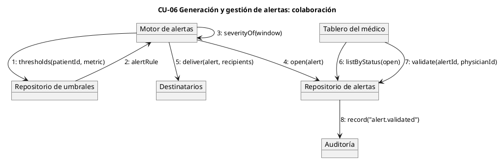

### 9.7 CU-07 Generación de reportes de seguimiento

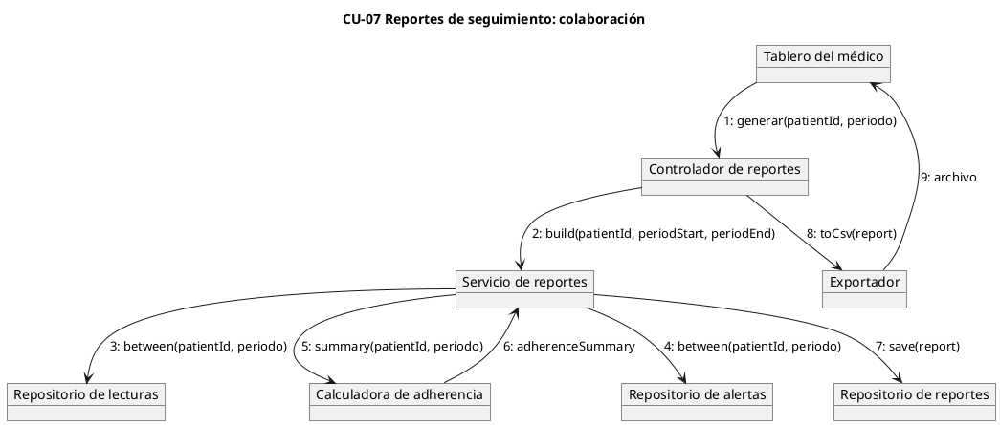

### 9.8 CU-08 Interacción por chat con el modelo

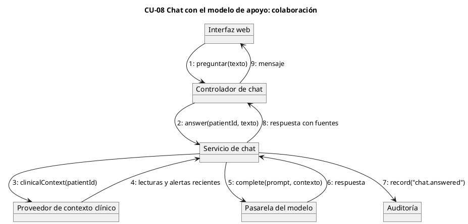

### 9.9 CU-09 Gestión de recordatorios y adherencia

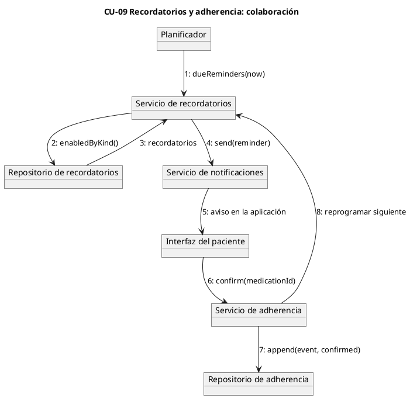

### 9.10 CU-10 Teleconsulta

```plantuml
@startuml
title CU-10 Teleconsulta: colaboración

object "Interfaz del paciente" as patient
object "Tablero del médico" as physician
object "Controlador de teleconsulta" as ctrl
object "Servicio de teleconsulta" as svc
object "Servicio de señalización" as signaling
object "Repositorio de teleconsultas" as repo

physician --> ctrl : 1: agendar(patientId, scheduledAt, mode)
ctrl --> svc : 2: schedule(...)
svc --> repo : 3: save(teleconsultation)
patient --> ctrl : 4: unirse(id)
ctrl --> svc : 5: start(id)
svc --> signaling : 6: openRoom(id)
signaling --> patient : 7: sesión de audio y vídeo
physician --> ctrl : 8: cerrar(id, notes)
ctrl --> svc : 9: close(id, notes)
svc --> repo : 10: save(notes)
@enduml
```

### 9.11 CU-11 Gestión de usuarios, roles y desactivación

```plantuml
@startuml
title CU-11 Gestión de usuarios y roles: colaboración

object "Tablero de administración" as ui
object "Guarda de autorización" as guard
object "Controlador de cuentas" as ctrl
object "Servicio de cuentas" as svc
object "Repositorio de usuarios" as users
object "Repositorio de tokens" as tokens
object "Auditoría" as audit

ui --> guard : 1: requireRole(admin)
guard --> ctrl : 2: autorizado
ctrl --> svc : 3: deactivate(userId, actor)
svc --> users : 4: pseudonymize(userId)
svc --> tokens : 5: revokeAll(userId)
svc --> audit : 6: record("accounts.deactivated")
svc --> ctrl : 7: confirmación
ctrl --> ui : 8: cuenta desactivada
@enduml
```

### 9.12 CU-12 Auditoría y trazabilidad

```plantuml
@startuml
title CU-12 Auditoría y trazabilidad: colaboración

object "Tablero de administración" as ui
object "Controlador de auditoría" as ctrl
object "Servicio de auditoría" as svc
object "Repositorio de auditoría" as repo

ui --> ctrl : 1: consultar(filtros)
ctrl --> svc : 2: search(actor, action, desde, hasta)
svc --> repo : 3: find(criteria)
repo --> svc : 4: eventos
svc --> svc : 5: orderByOccurredAt()
svc --> ctrl : 6: página de eventos
ctrl --> ui : 7: tabla filtrada
@enduml
```

## 10. Diagramas de secuencia por proceso

El mismo recorrido de la sección anterior, ahora ordenado en el tiempo y con los flujos
alternos que el manual describe en sus casos de uso extendidos. Los actores humanos se
dibujan como actores y las dependencias como participantes.

### 10.1 CU-01 Autenticación y acceso al sistema

```plantuml
@startuml
title CU-01 Autenticación y acceso al sistema
autonumber

actor "Usuario" as u
participant "Interfaz web" as ui
participant "API de sesión" as api
database "PostgreSQL" as pg

u -> ui : correo y contraseña
ui -> api : POST /api/auth/login
api -> pg : select user by email
alt correo desconocido o contraseña incorrecta
  api -> pg : insert audit_logs (login_failed, actor nulo)
  api --> ui : 401 Credenciales inválidas
  ui --> u : error genérico
else credenciales válidas
  api -> api : verifyPassword()
  api -> pg : insert refresh_tokens (solo el hash)
  api -> pg : insert audit_logs (login)
  api --> ui : 200 access, refresh, role
  ui --> u : sesión iniciada
end

u -> ui : refrescar
ui -> api : POST /api/auth/refresh
api -> pg : update refresh_tokens set revoked_at where revoked_at is null
alt token ya revocado
  api -> pg : revoke all refresh_tokens of the account
  api -> pg : insert audit_logs (refresh_reuse)
  api --> ui : 401 Sesión inválida o expirada
else token vigente y cuenta activa
  api -> pg : insert refresh_tokens (nuevo)
  api -> pg : insert audit_logs (refresh)
  api --> ui : 200 par nuevo
end
@enduml
```

### 10.2 CU-02 Gestión del consentimiento informado

```plantuml
@startuml
title CU-02 Gestión del consentimiento informado
autonumber

actor "Paciente" as p
participant "Interfaz web" as ui
participant "API de consentimiento" as api
database "PostgreSQL" as pg

p -> ui : lee el documento de la versión publicada
p -> ui : acepta
ui -> api : POST /api/consent
api -> pg : select patient_profiles by user
api -> pg : insert consents (version, acceptedAt)
api -> pg : insert audit_logs (consent.accepted)
api --> ui : 201 consentimiento vigente

p -> ui : revoca
ui -> api : POST /api/consent/revoke
api -> pg : update consents set revokedAt where revokedAt is null
api -> pg : insert audit_logs (consent.revoked)
api --> ui : 204

ui -> api : GET /api/consent?required_version=2
api -> pg : select consents where version = 2 and revokedAt is null
api --> ui : 200 active false, requires_acceptance_of_version 2
note right of api
  la aceptación es aditiva y nunca se reescribe;
  la revocación solo agrega la marca de tiempo
end note
@enduml
```

### 10.3 CU-03 Captura automática de signos vitales

```plantuml
@startuml
title CU-03 Captura automática de signos vitales
autonumber

participant "Tensiómetro" as dev
participant "Broker MQTT" as mq
participant "Servicio de ingesta" as ing
collections "MongoDB" as mongo
participant "Validador fisiológico" as val
database "PostgreSQL" as pg
participant "Motor de alertas" as alertas

dev -> mq : publica medición firmada
mq -> ing : entrega lote
ing -> ing : verifica firma y dispositivo
alt firma inválida o dispositivo desconocido
  ing -> pg : insert audit_logs (ingest_rejected)
  ing --> mq : rechazo
else mensaje válido
  ing -> mongo : append raw_readings
  ing -> pg : resuelve paciente del dispositivo
  ing -> val : validate(reading)
  val --> ing : validationStatus
  ing -> pg : insert readings
  ing -> alertas : evaluate(reading)
  alertas -> pg : insert alerts when the rule fires
end
@enduml
```

### 10.4 CU-04 Registro manual de presión arterial y síntomas

```plantuml
@startuml
title CU-04 Registro manual de presión y síntomas
autonumber

actor "Paciente" as p
participant "Interfaz web" as ui
participant "API de lecturas" as api
participant "Compuerta de consentimiento" as gate
participant "Validador fisiológico" as val
database "PostgreSQL" as pg
participant "Motor de alertas" as alertas

p -> ui : sistólica, diastólica, pulso y síntomas
ui -> api : POST /api/readings
api -> gate : isActive(patient, version)
alt sin consentimiento vigente
  gate --> api : false
  api --> ui : 403 Consentimiento requerido
  ui --> p : no se registran datos clínicos
else consentimiento vigente
  api -> val : validate(reading)
  val --> api : valid u out_of_range
  api -> pg : insert readings
  api -> pg : insert symptoms_mood
  api -> alertas : evaluate(reading)
  api -> pg : insert audit_logs (reading.created)
  api --> ui : 201 lectura registrada
  note right of api
    un valor implausible se guarda con
    validationStatus out_of_range
  end note
end
@enduml
```

### 10.5 CU-05 Análisis y clasificación de riesgo

```plantuml
@startuml
title CU-05 Análisis y clasificación de riesgo
autonumber

participant "Disparador" as trig
participant "Servicio de riesgo" as risk
database "PostgreSQL" as pg
participant "Clasificador por reglas" as rules
participant "Modelo de apoyo" as model
participant "Explicador" as expl

trig -> risk : assess(patient)
risk -> pg : lecturas de los últimos siete días
pg --> risk : lecturas
risk -> risk : construir ventana y descartar el primer día
alt menos de ocho lecturas válidas en dos días
  risk -> rules : insufficientData()
  rules --> risk : medium por datos insuficientes
else ventana suficiente
  risk -> rules : classify(window)
  rules --> risk : severidad por umbrales
  risk -> model : score(window)
  model --> risk : probabilidad de descontrol
  risk -> expl : factors(assessment)
  expl --> risk : factores y su peso
end
risk -> pg : insert audit_logs (risk.assessed)
risk --> trig : evaluación con explicación
@enduml
```

### 10.6 CU-06 Generación y gestión de alertas

```plantuml
@startuml
title CU-06 Generación y gestión de alertas
autonumber

participant "Motor de alertas" as eng
database "PostgreSQL" as pg
participant "Notificador" as noti
actor "Médico" as m
participant "Interfaz web" as ui

eng -> pg : select alert_config for the patient or global
pg --> eng : umbrales
eng -> eng : severityOf(window)
alt severidad distinta de low
  eng -> pg : insert alerts (open)
  eng -> noti : deliver to recipients
  noti -> m : alerta en la aplicación
else lectura dentro de rango
  eng -> pg : sin alerta; solo auditoría
end

m -> ui : abre la alerta
ui -> pg : select alerts where status = open
m -> ui : valida con nota
ui -> pg : update alerts set status validated, validatedBy, validatedAt
ui -> pg : insert audit_logs (alert.validated)
note right of pg
  ninguna alerta se cierra sin una persona
end note
@enduml
```

### 10.7 CU-07 Generación de reportes de seguimiento

```plantuml
@startuml
title CU-07 Reportes de seguimiento
autonumber

actor "Médico" as m
participant "Interfaz web" as ui
participant "API de reportes" as api
database "PostgreSQL" as pg
participant "Exportador" as exp

m -> ui : paciente y periodo
ui -> api : POST /api/reports
api -> pg : lecturas del periodo
api -> pg : alertas del periodo
api -> pg : eventos de adherencia
api -> api : calcula medias y adherencia
api -> pg : insert reports
api --> ui : 201 reporte
m -> ui : exportar
ui -> api : GET /api/reports/{id}?format=csv
api -> exp : toCsv(report)
exp --> api : archivo
api --> ui : 200 text/csv
note right of exp
  el PDF se declara pendiente en el manual;
  el CSV es la exportación entregada
end note
@enduml
```

### 10.8 CU-08 Interacción por chat con el modelo

```plantuml
@startuml
title CU-08 Interacción por chat con el modelo de apoyo
autonumber

actor "Paciente" as p
participant "Interfaz web" as ui
participant "API de chat" as api
participant "Proveedor de contexto" as ctx
database "PostgreSQL" as pg
participant "Pasarela del modelo" as gw

p -> ui : escribe una pregunta
ui -> api : POST /api/chat
api -> ctx : contexto clínico del paciente
ctx -> pg : lecturas y alertas recientes
ctx --> api : resumen con cifras
api -> gw : complete(prompt, contexto)
alt el modelo no responde
  api --> ui : 503 Servicio no disponible
  ui --> p : intenta de nuevo más tarde
else respuesta disponible
  api -> pg : insert audit_logs (chat.answered)
  api --> ui : 200 respuesta con fuentes
  ui --> p : mensaje
end
note right of api
  el chat no diagnostica ni prescribe:
  responde sobre los datos registrados
end note
@enduml
```

### 10.9 CU-09 Gestión de recordatorios y adherencia

```plantuml
@startuml
title CU-09 Recordatorios y adherencia
autonumber

participant "Planificador" as sch
participant "Servicio de recordatorios" as rem
database "PostgreSQL" as pg
participant "Notificador" as noti
actor "Paciente" as p
participant "Servicio de adherencia" as adh

loop cada minuto
  sch -> rem : dueReminders(now)
  rem -> pg : select reminders where enabled
  rem -> noti : send(reminder)
  noti -> p : aviso en la aplicación
  rem -> pg : update lastSentAt
end

p -> pg : confirma la dosis
pg --> adh : evento pendiente
adh -> pg : update adherence_events set confirmed
adh -> adh : recalcula tasa del periodo
alt la ventana venció sin confirmación
  adh -> pg : registra el evento como omitido
end
@enduml
```

### 10.10 CU-10 Teleconsulta

```plantuml
@startuml
title CU-10 Teleconsulta
autonumber

actor "Médico" as m
actor "Paciente" as p
participant "Interfaz web" as ui
participant "API de teleconsulta" as api
participant "Señalización" as sig
database "PostgreSQL" as pg

m -> ui : agenda la teleconsulta
ui -> api : POST /api/teleconsultations
api -> pg : insert teleconsultations (scheduled)
api --> ui : 201 con identificador

m -> ui : inicia la sesión
p -> ui : se une
ui -> api : POST /api/teleconsultations/{id}/join
api -> sig : openRoom(id)
sig --> m : audio y vídeo
sig --> p : audio y vídeo
alt la conexión se pierde
  sig --> api : sesión interrumpida
  api -> pg : update status interrupted
  p -> ui : reintenta
  ui -> api : join de nuevo
else sesión estable
  m -> ui : cierra con notas
  ui -> api : POST /api/teleconsultations/{id}/close
  api -> pg : update status finished, notes
end
@enduml
```

### 10.11 CU-11 Gestión de usuarios, roles y desactivación

```plantuml
@startuml
title CU-11 Gestión de usuarios, roles y desactivación
autonumber

actor "Administrador" as a
participant "Interfaz web" as ui
participant "API de cuentas" as api
participant "Guarda de autorización" as guard
database "PostgreSQL" as pg

a -> ui : abre la lista de cuentas
ui -> api : GET /api/accounts
api -> guard : currentUser(token)
guard -> pg : select role y active del actor
alt el actor no es administrador
  guard --> api : 403 Permiso denegado
  api --> ui : 403
else administrador activo
  api -> pg : select users order by email
  api --> ui : 200 lista de cuentas
end

a -> ui : cambia el rol de una cuenta
ui -> api : PATCH /api/accounts/{id}/role
api -> pg : update users set role, updatedAt
api -> pg : insert audit_logs (accounts.role_changed)

a -> ui : desactiva una cuenta
ui -> api : POST /api/accounts/{id}/deactivate
alt la cuenta es la del propio administrador
  api --> ui : 409 no se puede desactivar a sí mismo
else otra cuenta
  api -> pg : pseudonimiza email, nombre y contraseña; active false
  api -> pg : revoca los refresh_tokens vigentes
  api -> pg : insert audit_logs (accounts.deactivated)
  api --> ui : 204
end
@enduml
```

### 10.12 CU-12 Auditoría y trazabilidad

```plantuml
@startuml
title CU-12 Auditoría y trazabilidad
autonumber

actor "Administrador" as a
participant "Interfaz web" as ui
participant "API de auditoría" as api
participant "Guarda de autorización" as guard
database "PostgreSQL" as pg

a -> ui : filtra por actor, acción y fechas
ui -> api : GET /api/audit?action=...&from=...&to=...
api -> guard : currentUser(token)
guard --> api : administrador
api -> pg : select audit_logs with filters, order by occurredAt desc
api --> ui : 200 página de eventos
ui --> a : tabla con actor, acción, entidad, IP y detalle
note right of pg
  el detalle de una cuenta desactivada no guarda
  la identidad anterior: la seudonimización la borra
end note
@enduml
```

## 11. Diagrama de componentes

El sistema se organiza en una aplicación web, un servicio de API con módulos por dominio, dos
adaptadores de persistencia, el servicio de ingesta y el servicio del modelo. Los componentes
se comunican por HTTP con JSON, por el protocolo de PostgreSQL, por el protocolo de MongoDB y
por MQTT con los dispositivos.

```plantuml
@startuml
title Diagrama de componentes del sistema

skinparam componentStyle rectangle

package "Cliente" {
  [Aplicación web\n(React)] as web <<componente>>
  [Aplicación móvil\n(responsiva)] as mobile <<componente>>
}

package "Servicios del sistema" {
  [API de la plataforma\n(FastAPI)] as api <<componente>>

  package "Módulos de la API" {
    [Autenticación y sesión] as mod_auth <<módulo>>
    [Cuentas y roles] as mod_acc <<módulo>>
    [Consentimiento] as mod_cons <<módulo>>
    [Registro clínico] as mod_clin <<módulo>>
    [Riesgo y alertas] as mod_risk <<módulo>>
    [Reportes] as mod_rep <<módulo>>
    [Chat] as mod_chat <<módulo>>
    [Auditoría] as mod_aud <<módulo>>
  }

  [Servicio de ingesta\nMQTT] as ingest <<componente>>
  [Servicio del modelo\n(inferencia)] as model <<componente>>
  [Notificador en la aplicación] as notify <<componente>>
  [Exportador CSV y PDF] as export <<componente>>
}

package "Persistencia" {
  database "PostgreSQL 16\nregistro clínico" as pg
  database "MongoDB 7\nflujo crudo" as mongo
}

package "Dispositivos e integraciones" {
  [Tensiómetro] as device <<dispositivo>>
  [Broker MQTT] as broker <<infraestructura>>
  [Sistema externo\nHL7 FHIR] as fhir <<externo>>
}

package "Analítica fuera de línea" {
  [Cuaderno de entrenamiento] as train <<componente>>
  [Registro de modelos] as registry <<componente>>
}

web --> api : HTTPS, JSON
mobile --> api : HTTPS, JSON

api --> mod_auth
api --> mod_acc
api --> mod_cons
api --> mod_clin
api --> mod_risk
api --> mod_rep
api --> mod_chat
api --> mod_aud

mod_auth --> pg
mod_acc --> pg
mod_cons --> pg
mod_clin --> pg
mod_risk --> pg
mod_rep --> pg
mod_aud --> pg

mod_clin --> notify
mod_risk --> notify
mod_rep --> export

device --> broker : MQTT
broker --> ingest : MQTT
ingest --> mongo : lecturas crudas
ingest --> pg : lecturas validadas
ingest --> mod_risk : evaluación

mod_risk --> model : HTTP
mod_chat --> model : HTTP

train --> registry : artefacto
registry --> model : versión desplegada
model --> pg : lee variables clínicas

api --> fhir : FHIR R4

note bottom of mongo
  conserva el mensaje original del dispositivo
  aunque la lectura se rechace
end note
@enduml
```

## 12. Diagrama de distribución

Los contenedores corren en el servidor de aplicación; el navegador del paciente solo consume
la API por HTTPS. El entrenamiento del modelo ocurre fuera de línea y su artefacto se publica
como imagen para el servicio de inferencia.

```plantuml
@startuml
title Diagrama de distribución

node "Equipo del paciente o del médico" as cliente {
  artifact "Navegador" as browser
}

node "Servidor de aplicación" as app <<servidor>> {
  node "Contenedor web" as webc {
    artifact "Node 20: estáticos y proxy" as webart
  }
  node "Contenedor del backend" as apic {
    artifact "Python 3.12: uvicorn + FastAPI" as apiart
  }
  node "Contenedor de base de datos" as dbc {
    database "PostgreSQL 16" as pgart
    artifact "Volumen db_data" as pgvol
  }
  node "Contenedor del flujo crudo" as mongoc {
    database "MongoDB 7" as mongoart
    artifact "Volumen mongo_data" as mongovol
  }
  node "Contenedor del broker" as brokerc {
    artifact "Broker MQTT" as brokerart
  }
}

node "Red doméstica" as home {
  node "Tensiómetro" as dev <<dispositivo>> {
    artifact "Firmware de medición" as fw
  }
}

node "Estación de analítica" as ml <<servidor>> {
  artifact "Python 3.12: entrenamiento y evaluación" as mlart
  artifact "Modelo serializado" as model_art
}

cloud "Registro de imágenes" as registry

browser --> webart : HTTPS 443
webart --> apiart : HTTP 8000, red interna
apiart --> pgart : 5432, red interna
apiart --> mongoart : 27017, red interna
fw --> brokerart : MQTT 1883
brokerart --> apiart : HTTP, red interna
mlart --> registry : publica la imagen del modelo
registry --> apiart : descarga la versión
model_art --> apiart : inferencia por HTTP

note right of dbc
  solo el puerto publicado del compose
  es alcanzable desde el equipo del socio
end note
note bottom of ml
  el entrenamiento no corre dentro de la pila:
  usa el mismo repositorio y produce el artefacto
end note
@enduml
```

## Cómo renderizar

Cada bloque `plantuml` se copia completo, desde `@startuml` hasta `@enduml`, en la
herramienta web. Si prefieres la línea de comandos, con el archivo guardado:

```bash
plantuml -tpng docs/manual/diagramas-uml.md
```

El comando genera una imagen por bloque, en el mismo directorio que el archivo. Para revisar
el documento sin instalar nada, el servidor de PlantUML también acepta el archivo completo y
devuelve las imágenes en orden.
